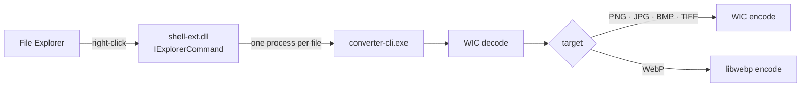

<div align="center">


# SnapFormat

**Right-click → Convert. Native image conversion for the Windows 11 File Explorer.**

[](https://github.com/marcantero/win11-quick-converter/actions/workflows/build.yml)
[](https://github.com/marcantero/win11-quick-converter/releases/latest)
[](https://github.com/marcantero/win11-quick-converter/releases)


[Download](https://github.com/marcantero/win11-quick-converter/releases/latest) ·
[Documentation](docs/README.md) ·
[Report a bug](https://github.com/marcantero/win11-quick-converter/issues/new) ·
[Roadmap](docs/roadmap.md)

</div>

---

SnapFormat adds a **Convert with SnapFormat** entry to the modern Windows 11 context menu. Select one or more images, pick a target format, and the converted files appear right next to the originals. No editor to open, no upload to a website, no waiting.

```
holiday.heic ──► To JPG  ──► holiday.jpg
logo.png     ──► To WebP ──► logo.webp
```

## ✨ Features

- **Built for the Windows 11 menu.** It is a real `IExplorerCommand` handler with a format submenu, not an entry hidden under *Show more options*.
- **Modern formats in, common formats out.** It reads HEIC, AVIF and WebP, and writes PNG, JPG, WebP, BMP and TIFF.
- **Batch conversion.** It converts up to 15 files at once and shows the native Windows progress dialog with a *Cancel* button.
- **Lightweight and fast.** It is native C++20 on top of the Windows Imaging Component, plus Google's `libwebp` for WebP encoding.
- **Safe for Explorer.** Conversions run in a separate process, so a broken image can never crash `explorer.exe`.
- **Scriptable.** The conversion engine is a standalone CLI you can use from PowerShell or batch files.
- **No admin rights needed.** The installer works per user.

## 🖼️ Supported formats

| Format | Read | Write | Notes |
|---|:---:|:---:|---|
| JPEG (`.jpg`, `.jpeg`) | ✅ | ✅ | Quality configurable from the CLI |
| PNG | ✅ | ✅ | Transparency preserved |
| WebP | ✅ | ✅ | Lossless by default, lossy with `--quality` |
| BMP | ✅ | ✅ | |
| TIFF (`.tif`, `.tiff`) | ✅ | ✅ | |
| HEIC | ✅ | — | Requires [HEIF Image Extensions](https://apps.microsoft.com/detail/9PMMSR1CGPWG) |
| AVIF | ✅ | — | Requires [AV1 Video Extension](https://apps.microsoft.com/detail/9MVZQVXJBQ9V) |

## 📦 Installation

**Requirements:** Windows 11 (build 22000 or later), x64.

### Installer (recommended)

1. Download **`SnapFormat_Setup.exe`** from the [latest release](https://github.com/marcantero/win11-quick-converter/releases/latest).
2. Run it. It installs per user and does not need administrator rights.
3. Right-click any image and choose **Convert with SnapFormat**.

> The installer is not code-signed yet, so SmartScreen may show a warning. Choose **More info → Run anyway**.

### MSIX sparse package

For people who need package identity: download `SnapFormat.zip`, extract it to a permanent folder, and run `install.bat`. This method needs administrator rights and the Windows SDK. See the [installation guide](docs/guides/installation.md) for details and security notes.

## 🚀 Usage

### From File Explorer

Select up to 15 images, right-click, open **Convert with SnapFormat**, and pick **To PNG**, **To JPG**, **To WebP**, **To BMP** or **To TIFF**.

Each output file keeps the original name with the new extension. An existing file with the same name is overwritten. More details are in the [usage guide](docs/guides/usage.md).

### From the command line

```powershell
$cli = "$env:APPDATA\SnapFormat\converter-cli.exe"

& $cli --input photo.heic --output photo.jpg  --format jpg  --quality 85
& $cli --input photo.png  --output photo.webp --format webp --quality 80
```

| Exit code | Meaning |
|:---:|---|
| `0` | Success |
| `1` | Invalid arguments |
| `2` | Validation failed (missing input or unsupported format) |
| `3` | Conversion failed |

Full reference: [CLI contract](docs/architecture/cli-contract.md).

## 🏗️ How it works



| Component | Role |
|---|---|
| [`src/shell-ext`](src/shell-ext) | In-process COM server loaded by Explorer. It builds the menu and starts the CLI, and does no image processing. |
| [`src/converter-cli`](src/converter-cli) | Headless conversion engine with a small, stable CLI contract and deterministic exit codes. |
| [`packaging`](packaging) | Inno Setup script, MSIX manifest and registration script. |

Read more in the [architecture overview](docs/architecture/overview.md).

## 🛠️ Building from source

**Prerequisites:** Visual Studio 2022 or later with *Desktop development with C++*, CMake 3.20 or later, and Git.

```powershell
git clone https://github.com/marcantero/win11-quick-converter.git
cd win11-quick-converter

cmake -S . -B build                      # fetches libwebp automatically
cmake --build build --config Release     # → build\bin\Release\

regsvr32 build\bin\Release\shell-ext.dll # register for the current user
```

To build the installer, run `iscc packaging\installer.iss` (requires Inno Setup 6). See the [build guide](docs/guides/building.md) for the development loop and packaging.

## 📚 Documentation

| | |
|---|---|
| **Guides** | [Installation](docs/guides/installation.md) · [Usage](docs/guides/usage.md) · [Troubleshooting](docs/guides/troubleshooting.md) · [Building](docs/guides/building.md) |
| **Architecture** | [Overview](docs/architecture/overview.md) · [CLI contract](docs/architecture/cli-contract.md) · [Conversion pipeline](docs/architecture/conversion-pipeline.md) · [Shell extension](docs/architecture/shell-extension.md) |
| **Project** | [Roadmap](docs/roadmap.md) · [Contributing](docs/development/contributing.md) · [Testing](docs/development/testing.md) · [ADRs](docs/adr/README.md) · [Project review](docs/development/project-review.md) |

## 🗺️ Roadmap

Planned work: a quality settings app ([#36](https://github.com/marcantero/win11-quick-converter/issues/36)), image resizing ([#38](https://github.com/marcantero/win11-quick-converter/issues/38)), toast notifications ([#39](https://github.com/marcantero/win11-quick-converter/issues/39)), watch folders ([#41](https://github.com/marcantero/win11-quick-converter/issues/41)) and a Winget package ([#42](https://github.com/marcantero/win11-quick-converter/issues/42)). See the [full roadmap](docs/roadmap.md).

## 🤝 Contributing

Contributions are welcome. Please read the [contributing guide](docs/development/contributing.md) first. In short, use modern C++ with RAII and `ComPtr`, keep image processing out of the DLL, and use Conventional Commits.

---

<div align="center">
<sub>Made with C++ for Windows 11 by <a href="https://github.com/marcantero">@marcantero</a></sub>
</div>
