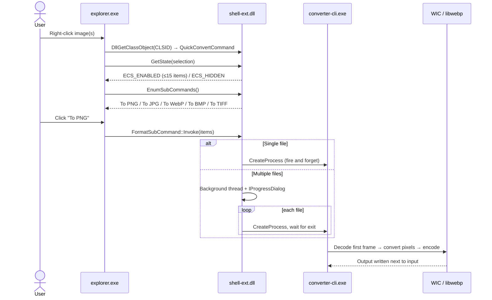

# Architecture Overview

SnapFormat is a CMake monorepo with two binaries and a packaging layer.

```
win11-quick-converter/
├── CMakeLists.txt              Root build: C++20, fetches libwebp v1.4.0, unified output dirs
├── src/
│   ├── converter-cli/          converter-cli.exe — headless conversion engine
│   │   ├── include/win11qc/    cli_options.h, wic_converter.h
│   │   └── src/                main.cpp (argument parsing), wic_converter.cpp (pipeline)
│   └── shell-ext/              shell-ext.dll — in-proc COM server (IExplorerCommand)
│       ├── include/win11qc/    shell_extension.h (CLSID, verb, titles)
│       ├── src/dummy.cpp       COM classes, registration, CLI invocation
│       ├── shell-ext.def       Exported COM entry points
│       ├── snapformat.ico      Menu icon (copied next to the DLL at build time)
│       └── test_com/           shell_ext_test_com.exe — COM activation smoke test
├── packaging/                  AppxManifest.xml, Assets/, register-msix.ps1, installer.iss
├── install.bat                 Elevating wrapper around register-msix.ps1 (ZIP distribution)
├── .github/workflows/build.yml CI build + release
└── docs/                       This documentation
```

## Components

### `converter-cli.exe` — conversion engine

A console application with no UI. It parses a small, stable [CLI contract](cli-contract.md), decodes the input with WIC, and encodes the output with either WIC or libwebp. It returns deterministic exit codes. See [Conversion pipeline](conversion-pipeline.md).

### `shell-ext.dll` — Explorer integration

An in-process COM server that Explorer loads. It exposes one top-level `IExplorerCommand` ("Convert with SnapFormat") with a submenu of target formats. When a format is chosen it spawns `converter-cli.exe` once per selected file. It contains **no conversion logic**. See [Shell extension](shell-extension.md).

### Packaging

Two independent ways to register the DLL with Explorer:

- **Inno Setup** (`SnapFormat_Setup.exe`) — per-user install; calls `DllRegisterServer`, which writes `HKCU` registry keys.
- **MSIX sparse package** (`SnapFormat.zip` + `install.bat`) — registers an identity package whose manifest declares the context-menu verb and COM surrogate server, pointing at binaries in an external location.

See [Packaging](../deployment/packaging.md).

## Architecture boundary

The single most important design rule (also recorded in [ADR 0001](../adr/0001-cli-contract.md)):

> The DLL only handles the context-menu interaction and spawns the CLI process. All image processing lives in the CLI.

Benefits:

- **Explorer stability** — decoder crashes or heavy memory use happen in a separate, short-lived process, not inside `explorer.exe`.
- **Testability** — the engine can be tested from a terminal or script without Explorer.
- **Reuse** — the CLI can be called by other tools (batch scripts, future watch-folder service, etc.).

## End-to-end flow



## Technology stack

| Area | Technology |
|---|---|
| Language | C++20 (MSVC, `/W4 /permissive-`) |
| Build | CMake ≥ 3.20, `FetchContent` |
| Imaging | Windows Imaging Component (`windowscodecs`) |
| WebP encoding | libwebp v1.4.0 (static, fetched at configure time) |
| COM | WRL (`Microsoft::WRL::RuntimeClass`, `ComPtr`) |
| Shell | `IExplorerCommand`, `IEnumExplorerCommand`, `IProgressDialog` |
| Packaging | Inno Setup 6, MSIX sparse package (`makeappx`, `signtool`) |
| CI/CD | GitHub Actions (`windows-latest`) |

## Identifiers

| Item | Value |
|---|---|
| COM CLSID | `{8D5F6D5B-18CB-4C7B-9E2D-6D8B125F551C}` |
| Shell verb (registry) | `snapformat.convert` |
| Shell verb (MSIX) | `snapFormatConvert` |
| Menu title | `Convert with SnapFormat` |
| MSIX package name | `SnapFormat` (publisher `CN=MarcAntero`) |
